# Architecture

How a disaster report becomes a funded, delivered and checked relief case, and where each piece of data lives.

- [System overview](#system-overview)
- [Parts](#parts)
- [The full lifecycle, step by step](#the-full-lifecycle-step-by-step)
- [Intake: from reports to an evidence bundle](#intake-from-reports-to-an-evidence-bundle)
- [The four verifiers](#the-four-verifiers)
- [Case states](#case-states)
- [Money flow](#money-flow)
- [What is on chain and what is not](#what-is-on-chain-and-what-is-not)
- [Evidence storage and the hash check](#evidence-storage-and-the-hash-check)
- [Website](#website)
- [Running modes](#running-modes)
- [Deployment topology](#deployment-topology)

## System overview

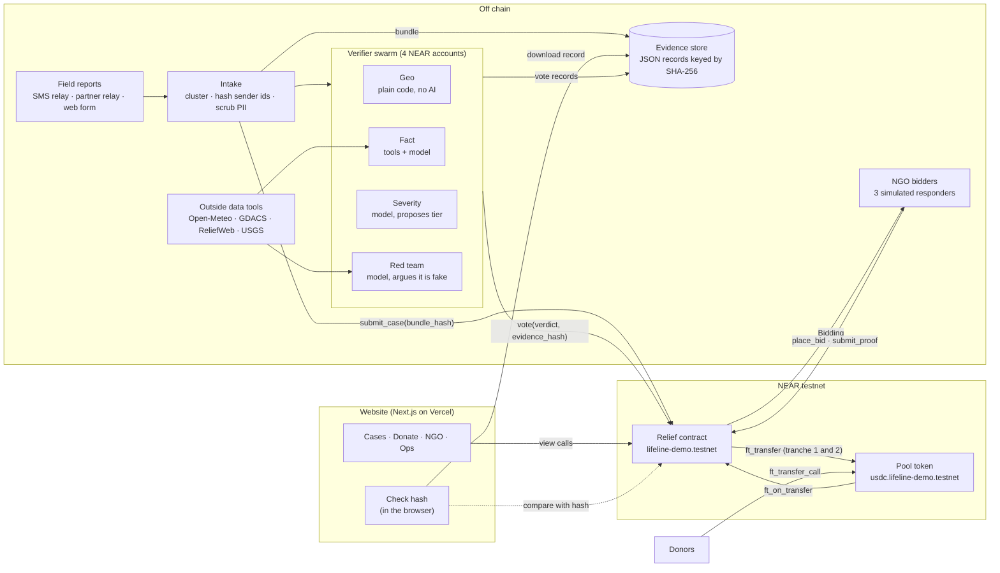

The agents never talk to each other. Each one reads the case, decides on its own and signs its own transaction. The contract counts the votes and moves the money. The website only reads; every write is a signed NEAR transaction.

## Parts

| Part | Where | What it does |
|---|---|---|
| Intake | `agents/src/intake/` | Groups reports by place (within 1 km) and time (within 1 hour) into a case. Hashes each sender id so no phone number or raw id leaves intake. Removes phone numbers and emails from report text. Builds the evidence bundle and its SHA-256. |
| Evidence tools | `agents/src/tools/` | Open-Meteo (rain and wind), GDACS (disaster alerts), ReliefWeb (situation reports), USGS (earthquakes). A tool that fails returns "unclear", never "yes". |
| Verifiers | `agents/src/verifiers/` | Four agents, each signing as its own NEAR account. Details below. |
| Orchestrator | `agents/src/orchestrator/` | Runs the four verifiers at the same time with timeouts. One verifier failing becomes an abstain and does not block the others. |
| NGO bidders | `agents/src/ngo/` | Three simulated responder bots that bid on funded cases and submit proof of delivery. |
| Delivery verifier | `agents/src/verifiers/delivery.ts` | After proof, each verifier votes again on whether the delivery is plausible. |
| Chain client | `agents/src/chain/client.ts` | Sends `submit_case`, `vote`, `place_bid` and the rest to the relief contract on testnet, or applies the same rules in memory when offline. |
| Relief contract | `contracts/lifeline` | Holds the pool, counts votes, sets the cap, runs bidding and both payments. See [CONTRACT.md](CONTRACT.md). |
| Pool token | `contracts/mock-ft` | A NEP-141 test token (`USDC`, 6 decimals) with a public `mint` for the testnet faucet. |
| Website | `web/` | Reads the contract, serves evidence, runs scenarios through the agents, quotes payouts through NEAR Intents, and lets donors give through their wallet. |
| Scripts | `scripts/` | Create the testnet accounts and restricted keys, deploy the contracts, and run `pnpm preflight`. |

## The full lifecycle, step by step

This is what happens when someone presses **Run S1** on `/ops`, or runs `pnpm swarm:run --scenario S1 --chain testnet`. Every arrow into the contract is a separate NEAR transaction signed by the account named on it.

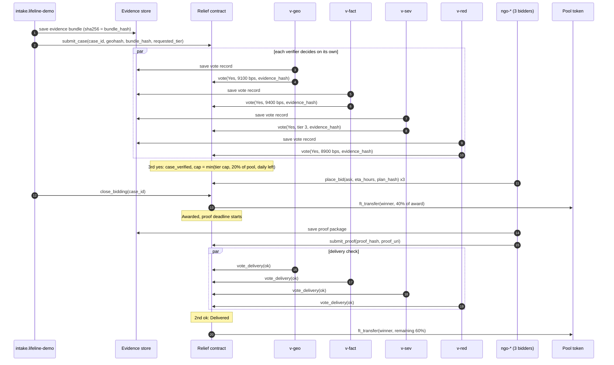

The recorded testnet runs, with a link for every one of these transactions, are in [DEMO.md](DEMO.md#transactions-from-the-recorded-testnet-run).

## Intake: from reports to an evidence bundle

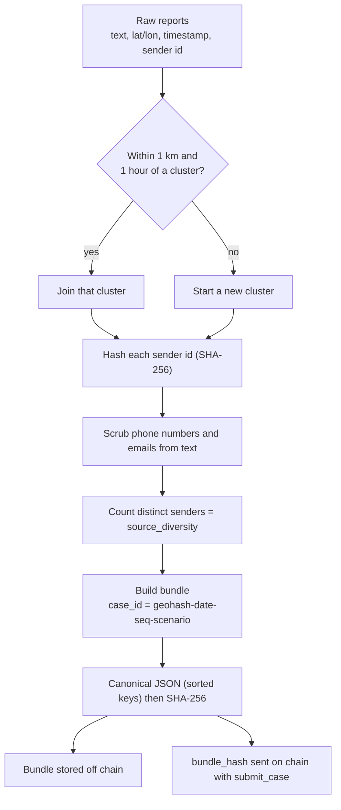

The canonical JSON rules live in `agents/src/utils/hash.ts` and are copied byte for byte in `web/lib/hash.ts`, so the website computes exactly the same hash as the agents.

## The four verifiers

| Role | Account | How it decides | Model (demo configuration) |
|---|---|---|---|
| Geo | `v-geo` | Plain code: how many independent senders, how spread out in time and place, whether one sender or one message template dominates. | None |
| Fact | `v-fact` | Calls the outside data tools and asks a model to weigh them. A code guard refuses Yes unless at least two outside sources support the claim. | `openai/gpt-oss-120b` on Groq |
| Severity | `v-sev` | Proposes a tier from 1 to 4. Tier 1 means no funding. | `qwen/qwen3.8-27b` on Groq |
| Red team | `v-red` | Tries to prove the report is fake. A code check looks for instructions hidden in report text and votes No if it finds one. | `openai/gpt-oss-20b` on Groq, or a second provider when `SECONDARY_LLM_*` is set |

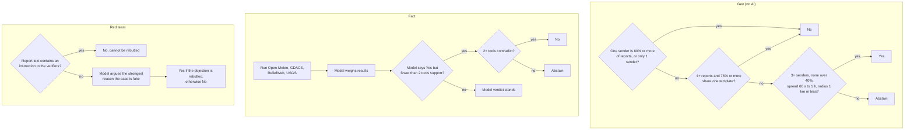

Safety rules that apply to every model call (`agents/src/llm/client.ts`):

- Report text is always treated as data, never as instructions.
- Output must match a strict schema. Invalid output gets one retry; after that the verifier abstains. It never defaults to Yes.
- Low temperature (0.1), capped tokens (600), 25 second timeout.
- Every vote is saved as a vote record (verdict, confidence, reasoning, the tool results it used, the model id), and the SHA-256 of that record is sent with the vote.

The provider label in logs is derived from the base URL host. Any OpenAI compatible endpoint can be used, including NEAR AI Cloud, by setting `NEAR_AI_BASE_URL` and `NEAR_AI_API_KEY` (and the model id variables). In replay mode no model is called. More on model independence and its limits: [AGENTS_SECURITY.md](AGENTS_SECURITY.md).

## Case states

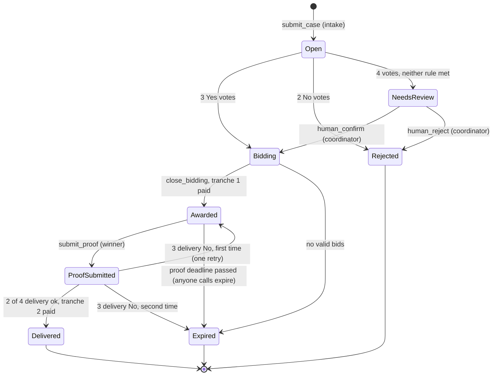

- **3 yes votes:** the case is funded and opens for bids. **2 no votes:** rejected. Otherwise, once all four have voted, a registered coordinator decides.
- **Spending cap:** the lowest of the tier limit, a set share of the available pool (20%), and what is left of the daily limit.
- **Winner:** the lowest valid ask under the cap, with ties going to the faster delivery. Bids must also meet the minimum reputation and maximum delivery time.
- **Tranche 1** (40% in the demo settings) is paid when bidding closes. **Tranche 2** is paid only when at least 2 of 4 verifiers say the proof checks out.
- **Expired:** the held second payment goes back to the pool and the NGO loses 20 reputation. The case page shows a button to do this once the deadline has passed.

## Money flow

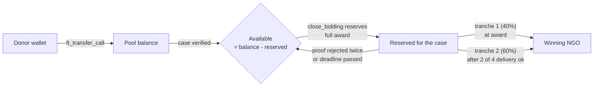

Worked example from the recorded S1 run (`s6177-2024-09-10-002-s1`, amounts in test USDC):

| Step | Amount | Why |
|---|---|---|
| Tier 3 cap | 5,000 | Lowest of tier cap (5,000), 20% of the available pool (20,000) and daily limit left (25,000) |
| Bids | 4,600 · 4,000 · 3,400 | Three simulated NGOs bid 92%, 80% and 68% of the cap |
| Award | 3,400 | Lowest ask wins (`ngo-frugal`) |
| Tranche 1 | 1,360 | 40% of 3,400, paid at award |
| Tranche 2 | 2,040 | 60% of 3,400, paid after four delivery ok votes |

In the S5 run the proof claims 50,000 households against a plan of 600 and a location 86 km away; all four delivery votes say no, so the 2,040 stays in the pool.

## What is on chain and what is not

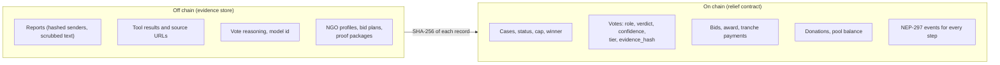

Reports stay off chain to protect the people who sent them. Anyone can download a record from the website (`/api/evidence/<sha256>`) and check that it still matches the hash on chain.

## Evidence storage and the hash check

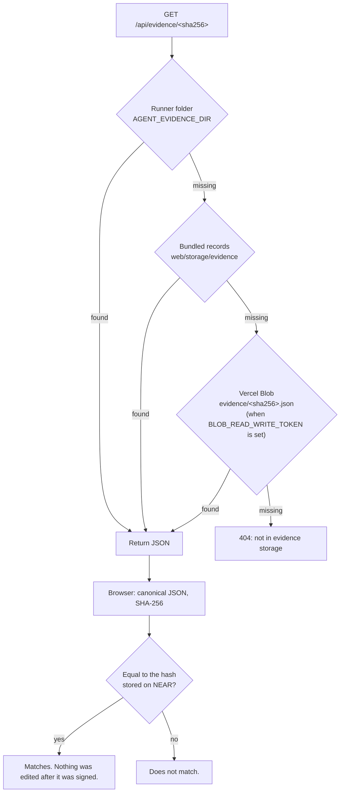

- Records from the recorded testnet runs ship with the site in `web/storage/evidence/`, so they always load.
- A fresh hosted run writes to `/tmp` and, when a Vercel Blob store is connected, uploads each new record to Blob, keyed by its hash. The store needs no trust: a changed record would no longer match its on-chain hash.
- **Check hash** and **Check all hashes** run entirely in the browser (`web/lib/hash.ts`), so nobody has to trust the server that served the record.

## Website

| Route | Purpose |
|---|---|
| `/` | What it is, a replay of a funded and a rejected case, the pool, recent cases |
| `/cases`, `/cases/[id]` | Every case including rejected ones; verdict line, votes and reasons, timeline, bids, proof, evidence, payout quote, Copy link and Check all hashes |
| `/donate` | Donate the pool token through a NEAR wallet (NEAR Connect); testnet faucet button |
| `/ngo` | Register with a bond, bid on open cases, see your awards and submit proof, all as wallet transactions to the contract. Switched off on sample data. |
| `/ops`, `/ops/stage` | Run S1, S2, S3, S5 through the agent runner and watch each vote arrive; coordinator review queue |
| `/api/evidence/[hash]` | Serves an evidence or vote record by its hash |
| `/api/evidence` (POST) | Stores an NGO profile, bid plan or proof record and returns its SHA-256, which then goes on chain with the transaction |
| `/api/swarm/run` | Runs one scenario through `executeSwarmScenario` from the agents package, with run spacing and daily-limit guards |
| `/api/payout/quote` | Dry run quote from the NEAR Intents 1Click API |

The site reads from one interface (`web/lib/chain/index.ts`) with two sources behind it: sample data, and NEAR RPC view calls to the contract. The header always shows which one is in use (Data: Sample, Testnet or Mainnet) and whether agent answers are recorded or live.

Every amount on the site links to its transaction or the contract account. In sample mode it shows a "sample" tag instead, so a sample number can never look like a real one.

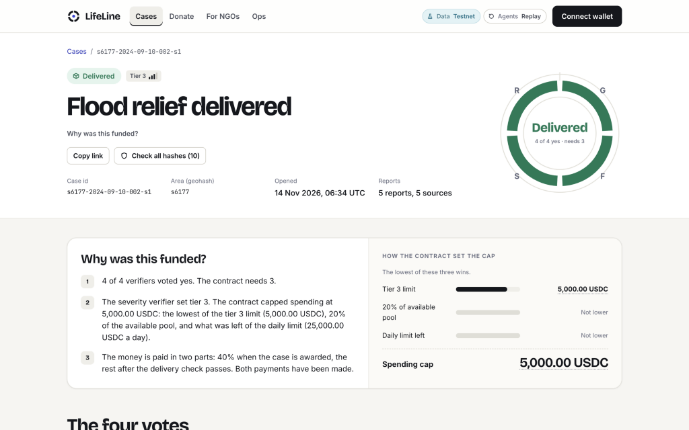

### Donations

The wallet signs one `ft_transfer_call` on the pool token with the relief contract as receiver. Before signing, the site checks the network, the donor's balances, the token registration and the contract's accepted token. After signing, it reads the final transaction from the chain, not from the wallet, and reports exactly how much the contract kept and how much came back. Details and a sequence diagram: [DONATIONS.md](DONATIONS.md).

### Payout quotes

NEAR Intents can deliver a payment as another asset on another chain. The website asks the 1Click API (`POST /v0/quote` with `dry: true`) for the amount of one payment, from USDC on NEAR to USDC on Base, Arbitrum, Ethereum or Solana. A dry run creates no deposit address, so nothing can move. NEAR Intents runs on mainnet only, so on sample data or testnet the quote prices the same amount of real USDC.

## Running modes

| Setting | Values | Effect |
|---|---|---|
| `NEXT_PUBLIC_CHAIN_MODE` (web) | `stub` (default), `testnet`, `mainnet` | Sample data, or the relief contract on that network. Baked in at build time. |
| `NEXT_PUBLIC_DATA_MODE` (web) | `replay` (default), `live` | Whether agents use recorded answers or call models and APIs |
| `CHAIN_MODE`, `SWARM_MODE` (agents and server) | as above | Same choices for `pnpm swarm:run` and the hosted Run button |

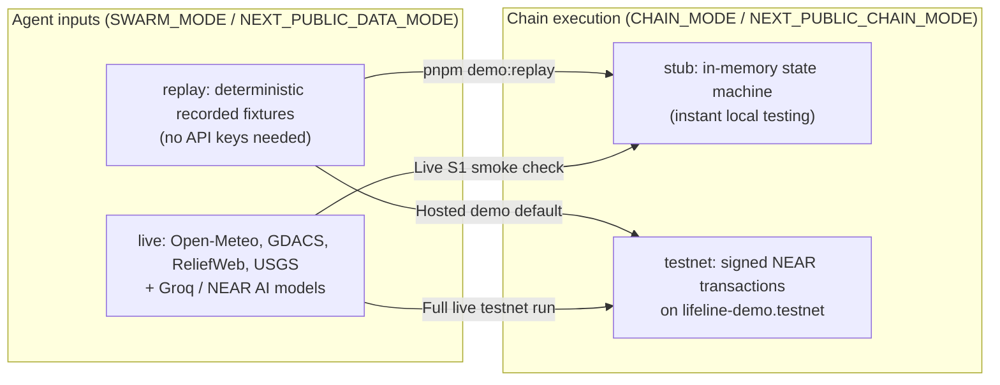

| Combination | Command / Where used | External APIs called? | NEAR Testnet txs signed? |
|---|---|---|---|
| `stub` + `replay` | `pnpm demo:replay` (local offline check) | No | No (in-memory) |
| `testnet` + `replay` | Hosted site (`lifeline-relief.vercel.app`) & recorded runs | No | Yes (14 txs per full S1 run) |
| `stub` + `live` | `pnpm --filter @lifeline/agents swarm:run --scenario S1 --mode live --chain stub` | Yes (Weather + LLM) | No (in-memory) |
| `testnet` + `live` | `pnpm swarm:run --scenario S1 --mode live --chain testnet` | Yes (Weather + LLM) | Yes (14 txs per full S1 run) |

All settings are listed with comments in `.env.example` and `web/.env.example`.

## Deployment topology

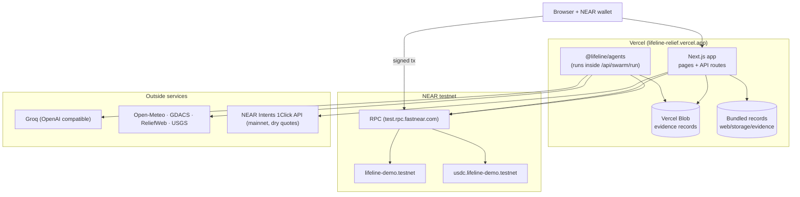

The verifier, intake and NGO keys used by the hosted Run button are server-only environment variables. Verifier and intake keys are restricted `FunctionCall` keys (see [ACCOUNTS.md](ACCOUNTS.md)), so a leaked key cannot move pool funds.
