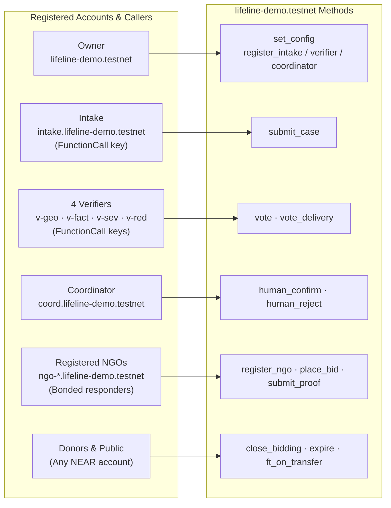
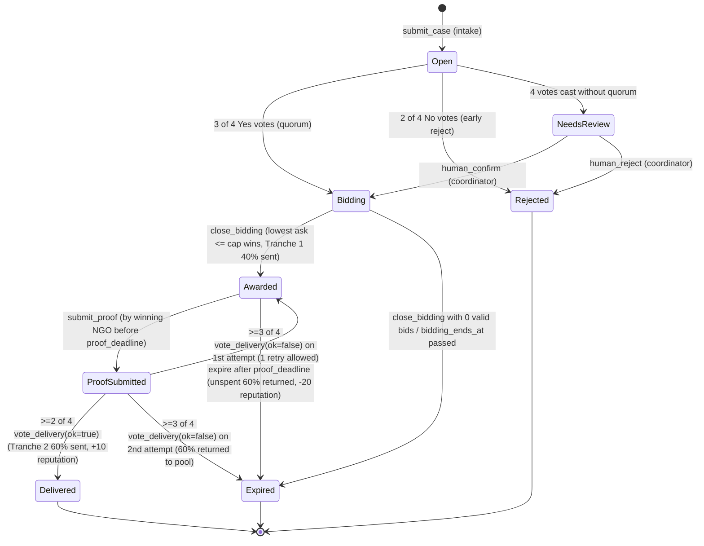
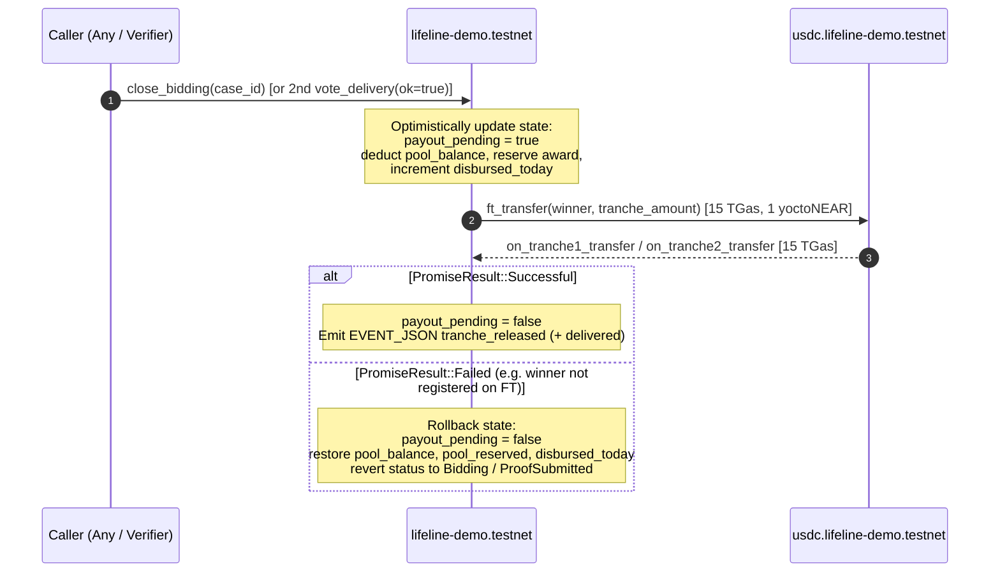

# LifeLine Smart Contracts

This document specifies the NEAR smart contracts in `contracts/` (`lifeline` and `mock-ft`), their state machine, access controls, gas/deposit requirements, NEP-297 events, and deployment workflow.

## Artifacts & Build

Built with Rust (`+1.85.0` with `-Z build-std=std,panic_abort` targeting `wasm32-unknown-unknown` with `contracts/.cargo/config.toml` MVP WASM flags `-C target-cpu=mvp` and `-C target-feature=-reference-types,-multivalue,-bulk-memory,-nontrapping-fptoint`):

| Contract | Source | Artifact | Size | Role |
|---|---|---|---|---|
| `lifeline` | `contracts/lifeline/src/lib.rs` | `contracts/res/lifeline.wasm` | ~437 KB | Disaster relief pool escrow, verifier quorum, cap governor, reverse auction, two-tranche delivery settlement |
| `mock-ft` | `contracts/mock-ft/src/lib.rs` | `contracts/res/mock_ft.wasm` | ~235 KB | NEP-141 + NEP-145 + NEP-148 demo stablecoin (`Mock USDC` / `mUSDC`, 6 decimals) |

```bash
pnpm build:contracts   # Compiles MVP wasm32 binaries and updates contracts/res/*.wasm
pnpm test:contracts    # Runs Rust unit tests (13 lifeline + 3 mock-ft = 16 tests)
pnpm test:e2e          # Runs NEAR sandbox E2E tests (8 donate + 6 lifeline = 14 tests)
```

---

## `contracts/lifeline`

### Initialization & Configuration

- `new(owner: AccountId, pool_token: AccountId, config: Option<ConfigInput>) -> Self`
  Initializes the contract with `owner`, the NEP-141 `pool_token` account, and optional `ConfigInput` overrides.
- `set_config(config: ConfigInput)` *(owner only)*
  Updates mutable parameters (`bidding_window_secs`, `proof_deadline_secs`, `tranche1_bps`, `tier_cap`, `max_case_bps`, `daily_limit`, `min_reputation`, `max_eta_hours`).

Default configuration values:

| Parameter | Default | Meaning |
|---|---|---|
| `bidding_window_secs` | `90` | Seconds a verified case remains open for NGO bids |
| `proof_deadline_secs` | `300` | Seconds after `Awarded` within which proof must be submitted |
| `tranche1_bps` | `4000` | Tranche 1 share in basis points (`40%`); remainder (`60%`) is Tranche 2 |
| `tier_cap` | `[0, 2_000_000_000, 5_000_000_000, 10_000_000_000]` | Per-tier hard cap in base units (6 decimals: Tier 1 = \$2k, Tier 2 = \$5k, Tier 3 = \$10k) |
| `max_case_bps` | `2000` | Max share of available pool per case (`20%`) |
| `daily_limit` | `25_000_000_000` | 24-hour rolling disbursement limit (\$25k at 6 decimals) |
| `min_reputation` | `0` | Minimum NGO reputation required to place a bid |
| `max_eta_hours` | `168` | Maximum allowed delivery ETA (`7 days`) |

### Roles & Access Control

Owner registration methods (require `env::predecessor_account_id() == self.owner`):
- `register_intake(account: AccountId)` — authorizes the intake service account to open cases.
- `register_verifier(account: AccountId, role: Role)` — binds an account to one verifier role (`"geo" | "fact" | "sev" | "red"`).
- `register_coordinator(account: AccountId)` — authorizes the human coordinator account for split-vote tie-breaking.

NGO registration (permissionless with sybil bond):
- `register_ngo(profile_hash: String)` *(payable)* — requires attached NEAR deposit `> 0` (recommended `1 NEAR` bond).

Verifier & intake keys created by `scripts/create-accounts.ts` are **restricted `FunctionCall` access keys** (`0` NEAR allowance for value transfers, scoped strictly to `submit_case` for `intake`, and `vote` / `vote_delivery` for `v-geo`, `v-fact`, `v-sev`, `v-red`). See [ACCOUNTS.md](ACCOUNTS.md).



### Cap Governor Formula

When a case is verified (tier `1..=3`), its spending `cap` is computed dynamically at the moment bidding closes and at bid validation as the minimum of three bounds:

$$\text{cap} = \min\Big(\text{tier\_cap}[\text{tier}],\; \left\lfloor \frac{\text{available} \times \text{max\_case\_bps}}{10000} \right\rfloor,\; \max(0,\; \text{daily\_limit} - \text{disbursed\_today})\Big)$$

where `available = pool_balance - pool_reserved`. Rolling daily window resets every `86_400` seconds (`NANOS_PER_DAY`). Bids exceeding `cap` are rejected.

### Case Lifecycle & State Transitions



| Method | Caller | Gas / Deposit | Behavior |
|---|---|---|---|
| `ft_on_transfer(sender_id, amount, msg)` | `pool_token` (via `ft_transfer_call`) | Standard FT callback | Credits `pool_balance`, records `Donation`, returns `U128(0)`. Only accepts transfers from `pool_token`. |
| `submit_case(case_id, geohash, bundle_hash, requested_tier)` | Registered intake | Standard | Opens a new case (`Status::Open`). |
| `vote(case_id, verdict, confidence_bps, tier, evidence_hash, attestation_hash)` | Registered verifier | Standard | Records one vote per role. Early-settles on `3` Yes (`Bidding`) or `2` No (`Rejected`), or transitions to `NeedsReview` once all 4 vote without quorum. `tier` determines the verified tier upon funding. |
| `human_confirm(case_id)` / `human_reject(case_id)` | Registered coordinator | Standard | Resolves `NeedsReview` cases either into `Bidding` (calculating initial cap) or `Rejected`. |
| `place_bid(case_id, ask, eta_hours, plan_hash, simulated)` | Registered NGO | Standard | Submits or updates a sealed/open ask `<= cap`, with `ngo.reputation >= min_reputation` and `eta_hours <= max_eta_hours`. |
| `close_bidding(case_id)` | Any | `100 TGas` recommended (`GAS_FOR_FT_TRANSFER = 15 TGas` + `GAS_FOR_PAYOUT_CALLBACK = 15 TGas`) | Picks lowest valid ask under current `cap` (tie-breaker: lower `eta_hours`), reserves full `award_amount`, sets `Awarded`, triggers `ft_transfer` for Tranche 1 + `on_tranche1_transfer` callback. Expires case if `0` valid bids. |
| `submit_proof(case_id, proof_hash, proof_uri)` | Case `winner` | Standard | Moves `Awarded` (within `proof_deadline`) to `ProofSubmitted`. |
| `vote_delivery(case_id, ok, evidence_hash)` | Registered verifier | `100 TGas` recommended | Records one delivery vote per role per proof round. `>= 2` `ok` votes move to `Delivered` and trigger Tranche 2 `ft_transfer` + `on_tranche2_transfer`. `>= 3` `false` votes: allows 1 retry (`Awarded`, clearing delivery votes) on first rejection, or `Expired` (releasing remaining `pool_reserved`) on second rejection. |
| `expire(case_id)` | Any | Standard | After `bidding_ends_at` (for `Bidding`/`Verified`) or `proof_deadline` (for `Awarded`), sets `Expired`, releases unspent `pool_reserved`, and applies reputation penalty (`-20`) + failed count on `Awarded` timeouts. |

### Failed Payout Rollback (`on_tranche1_transfer` / `on_tranche2_transfer`)

Both `#[private]` callbacks check `env::promise_result(0)`:
- On `PromiseResult::Successful(_)`: emits `tranche_released` (and `delivered` on Tranche 2).
- On failure (e.g., winner lacks `storage_deposit` on `pool_token`): restores `pool_balance`, `pool_reserved`, `disbursed_today`, and reverts `Case.status` / paid counters (`Bidding` on Tranche 1 failure, `ProofSubmitted` on Tranche 2 failure), adjusting winner reputation accordingly. While a transfer is in flight (`payout_pending`), concurrent `close_bidding`, `vote_delivery`, or `expire` calls on that case are blocked.



### View Methods

- `get_config() -> ContractConfigView`
- `get_pool() -> PoolView` (`pool_balance`, `pool_reserved`, `available`, `daily_limit`, `disbursed_today`, `remaining_daily`)
- `get_case(case_id: String) -> Option<Case>`
- `list_cases(from?: u64, limit?: u64, status?: Status) -> Vec<Case>`
- `get_votes(case_id: String) -> Vec<Vote>`
- `get_bids(case_id: String) -> Vec<Bid>`
- `get_delivery_votes(case_id: String) -> Vec<DeliveryVote>`
- `get_ngo(account_id: AccountId) -> Option<Ngo>`
- `get_donations(from?: u64, limit?: u64) -> Vec<Donation>`

### NEP-297 Events (`EVENT_JSON`)

All logs use `"standard": "lifeline"`, `"version": "1.0.0"`, with `event` in:
- `donation`
- `case_opened`
- `vote_cast`
- `case_verified`
- `bidding_opened`
- `case_rejected`
- `needs_review`
- `bid_placed`
- `awarded`
- `tranche_released`
- `proof_submitted`
- `delivered`
- `expired`

---

## `contracts/mock-ft`

Minimal NEAR Fungible Token (`contracts/mock-ft/src/lib.rs`) used for local sandbox and testnet pool liquidity:
- `new_default_meta(owner_id: AccountId, total_supply: U128)` — initializes `Mock USDC` (`mUSDC`, 6 decimals).
- `new(owner_id: AccountId, total_supply: U128, metadata: FungibleTokenMetadata)`
- Implements NEP-141 (`ft_transfer`, `ft_transfer_call`, `ft_resolve_transfer`, `ft_total_supply`, `ft_balance_of`), NEP-145 (`storage_deposit`, `storage_withdraw`, `storage_unregister`, `storage_balance_of`, `storage_balance_bounds`), and NEP-148 (`ft_metadata`).

---

## Environments & Deployment Status

| Environment | Status | Details |
|---|---|---|
| **Local NEAR Sandbox** | **Verified** | `pnpm test:e2e` deploys real `mock_ft.wasm` and `lifeline.wasm`, tests restricted keys, donations/refunds, negative security checks, cap governor, `ft_transfer` failure rollback, agent scenarios S1–S5, and proof-deadline expiry (14/14 passing). |
| **NEAR Testnet** | **Deployed Live** | Relief contract deployed and initialized at [`lifeline-demo.testnet`](https://testnet.nearblocks.io/address/lifeline-demo.testnet); pool token [`usdc.lifeline-demo.testnet`](https://testnet.nearblocks.io/address/usdc.lifeline-demo.testnet) initialized with `1,000,000` `USDC` (6 decimals) and relief pool seeded with `100,000 USDC` (`100000000000`). Intake, coordinator, 4 verifiers, and 3 NGOs (`0.1 NEAR` bond each) registered on-chain. See [ACCOUNTS.md](ACCOUNTS.md). |
| **NEAR Mainnet** | **Skipped (out of scope)** | Intentionally omitted for hackathon scope; contract logic, tests, and testnet deployment scripts are the target deliverables. |
