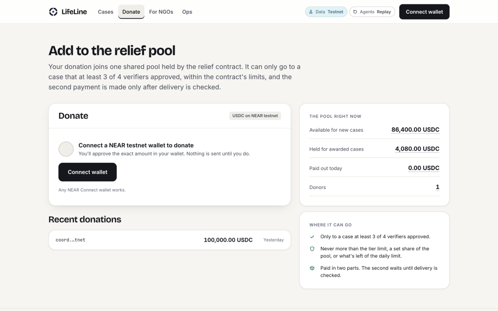
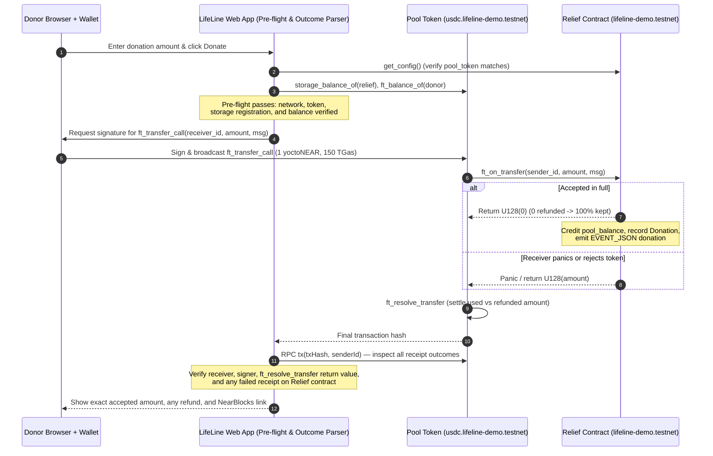

# How donations work

This is the agreement between the relief contract (developer A) and the web app (developer C). If the contract follows it, the donate page works without changes.



## End-to-End Donation Flow



## The transaction

A donor's wallet signs one transaction to the pool token:

```
receiver: <pool token>
method:   ft_transfer_call
args:     { "receiver_id": "<relief contract>", "amount": "<base units>", "msg": "<NEXT_PUBLIC_DONATION_MSG, default empty>" }
deposit:  1 yoctoNEAR (required by NEP-141)
gas:      150 TGas (NEXT_PUBLIC_DONATE_GAS_TGAS)
```

The token then calls `ft_on_transfer(sender_id, amount, msg)` on the relief contract.

## What the relief contract must do

1. **Be registered with the token.** The deploy script calls `storage_deposit({ account_id: <relief> })` on the token. Without it the token refuses the transfer. The site checks this and pauses donations if it's missing.
2. **Accept only the pool token.** In `ft_on_transfer`, check `env::predecessor_account_id() == pool_token`. For any other token, return the full `amount` (or panic) so the sender gets everything back.
3. **Return the unused amount.** Return `"0"` (as `U128`) when the whole donation is kept. Return the part to give back if only some is kept. A panic refunds everything. The site reads the token's final answer and tells the donor exactly what was kept and what came back, including the panic message.
4. **Record the donation.** Add to the pool, store `Donation { donor: sender_id, amount, at }`, and emit the `donation` event (NEP-297).
5. **Expose `get_config`** with a `pool_token` field. The site compares it with its own setting and pauses donations if they differ.

## Test tokens on testnet

If `NEXT_PUBLIC_TEST_TOKEN_FAUCET=true`, the donate page shows "Get 100 test tokens". It sends one transaction to the token with:

1. `storage_deposit({ account_id: <donor>, registration_only: true })`, attaching `storage_balance_bounds().min`. This is only included if the donor isn't registered yet.
2. `mint({ to: <donor>, amount })`.

So the testnet `mock-ft` needs a public `mint(to, amount)`. Never set the faucet flag on a mainnet build. The site ignores it outside testnet anyway.

## How the result is checked

The site never trusts the wallet's report. It takes the transaction hash, asks the NEAR RPC for the final outcome, and checks four things:

- The transaction went to the expected token, from the expected signer, with the expected receiver and amount.
- The overall status.
- The used amount returned by `ft_resolve_transfer`.
- Any failed receipt on the relief contract.

The parser is tested on real mainnet outcomes (accepted, partial, refunded, receiver panicked) in `web/lib/near/outcome.test.ts`, and end to end on a local sandbox in `web/e2e/donate.e2e.test.ts`.
